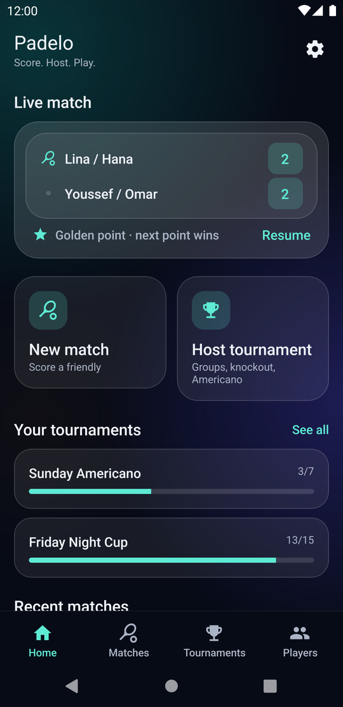
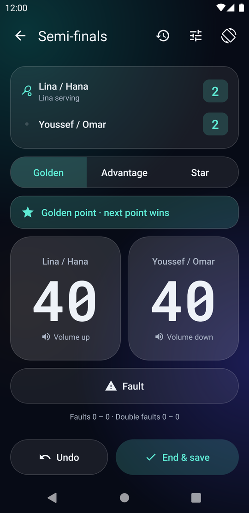
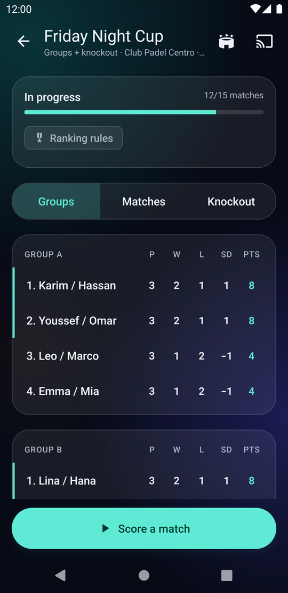
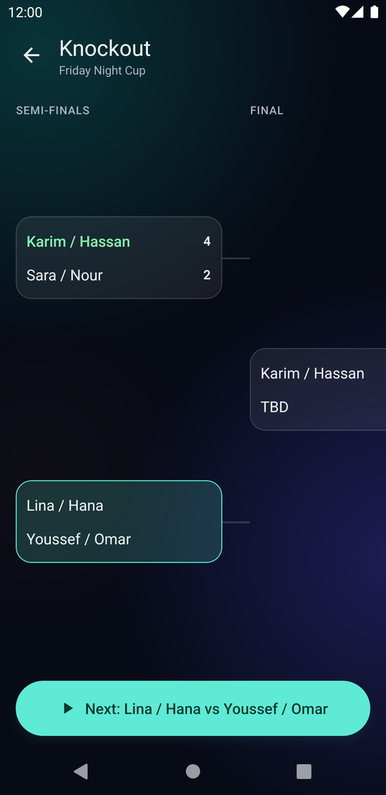
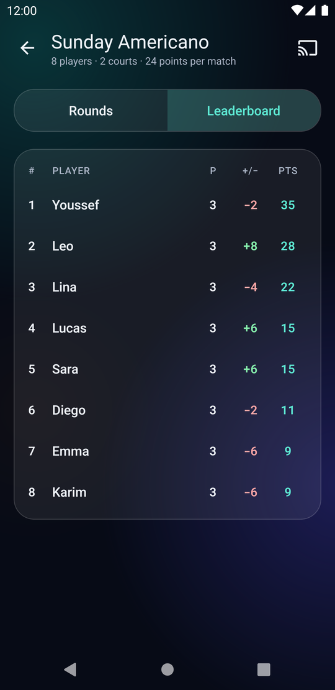
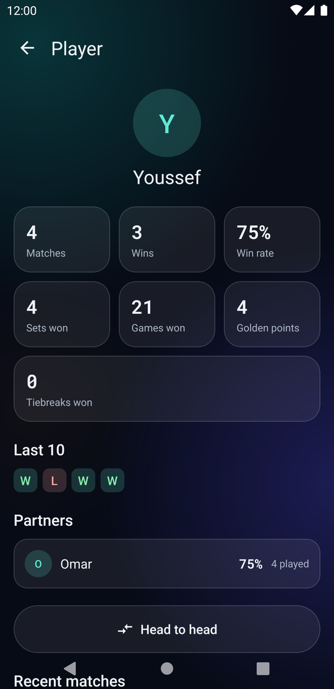
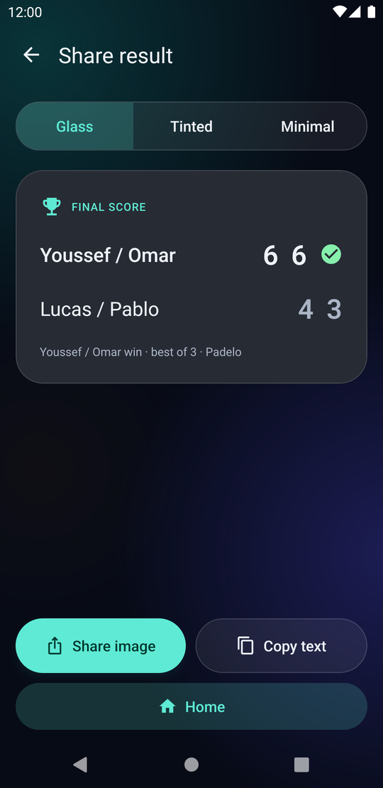

# Padelo

**Score padel matches point by point and run tournaments from your phone. Offline, no account, no ads.**

[](https://github.com/Mohamed0Hussein/padelo/actions/workflows/test.yml)
[](https://github.com/Mohamed0Hussein/padelo/actions/workflows/build-android.yml)
[](LICENSE)


<p align="center">
  
  
  
</p>

## Features

**Scoring that knows padel**
- Golden point, advantage, or star point at 40–40, switchable mid-match.
- Tiebreaks and super tiebreak, change-of-ends alerts, serve tracking, faults and double faults.
- Undo any point, with a full point history.
- **Volume-key scoring:** volume up gives the point to team 1, volume down to team 2, so the phone can stay in your pocket. The system volume doesn't change.
- **Courtside view:** landscape with huge numbers, lockable pads, and the screen stays on.
- Optional vibration and spoken score after every point.

**Tournaments**
- Round robin, groups + knockout, knockout with byes, and Americano.
- Automatic draw that keeps the top seeds apart, live group tables, and a bracket that fills itself.
- Court assignment, configurable ranking rules, final placings and CSV export.

**Players and sharing**
- Player profiles with form, partner win rates and head-to-head, worked out from your saved matches.
- A result card image to share after every match.
- Dark and light themes, or follow the system.

<p align="center">
  
  
  
  
</p>

## Download

Get the latest APK from [Releases](https://github.com/Mohamed0Hussein/padelo/releases) and open it on your phone. You may need to allow installing apps from your browser or file manager. Builds are for 64-bit Android phones.

Padelo updates itself: small fixes arrive in the background, and **Settings › Check for updates** fetches the latest one straight away.

## Privacy

Everything stays on your phone: matches, tournaments and players are stored in a local database. There are no accounts, analytics or ads. The only network request is the app's own update check, sent to Expo's update service.

## Build from source

You need Node 24 and Android Studio, with an emulator or a phone with USB debugging.

```bash
git clone https://github.com/Mohamed0Hussein/padelo.git
cd padelo
npm ci
npx expo run:android
```

Padelo includes its own native code (volume keys), so it runs as a [development build](https://docs.expo.dev/develop/development-builds/introduction/), not in Expo Go. `expo run:android` builds and installs it; after that, `npm start` is enough while you edit JavaScript.

On Windows, clone into a short folder such as `C:\dev\padelo`. The Android build tools fail on very long paths.

| Command | What it does |
| --- | --- |
| `npm start` | Start the dev server |
| `npm run android` | Build and run the development build |
| `npm test` | Run all tests |
| `npm run lint` | ESLint |
| `npx tsc --noEmit` | Typecheck |
| `npm run build:android` | Signed release APK built on your machine (`-- --aab` for a Play Store bundle) |
| `npm run update -- --message "..."` | Publish an over-the-air update |

How releases, updates and signing work: [docs/RELEASING.md](docs/RELEASING.md).

## How it's built

[Expo](https://expo.dev) and React Native with TypeScript. Navigation with Expo Router, state in Zustand, storage in SQLite, and React Native Paper for the base components.

```
src/
  engine/       Scoring engine: pure TypeScript, point(state, team) and undo(state)
  store/        Zustand store; screens never change scores directly
  db/           SQLite persistence (one table of JSON documents)
  tournament/   Draw, knockout, standings, ranking order, Americano rotation
  app/          Screens (Expo Router)
  ui/  theme/   Shared components and the dark/light palettes
  lib/          Stats, update checks, scoring controls (haptics, speech, volume keys)
modules/volume-keys/   Small Expo native module (Kotlin) that catches the volume keys
docs/                  Product spec, scoring rules, release guide
```

The scoring engine is checked against point-by-point fixtures for every rule variant. Tests also cover the tournament logic, whole matches and tournaments played through the store, and every screen (React Native Testing Library). They run on every push.

## Known limits

- **Share live** has no backend yet. The screen exists, but the link is a placeholder and nothing is uploaded.
- **Volume-key scoring** is Android only.
- **iOS** builds from the same code but hasn't been tested on a device.

## Contributing

Issues and pull requests are welcome; see [CONTRIBUTING.md](CONTRIBUTING.md). The scoring rules are described in [docs/SCORING.md](docs/SCORING.md).

## License

[MIT](LICENSE) © 2026 Mohamed Hussein
